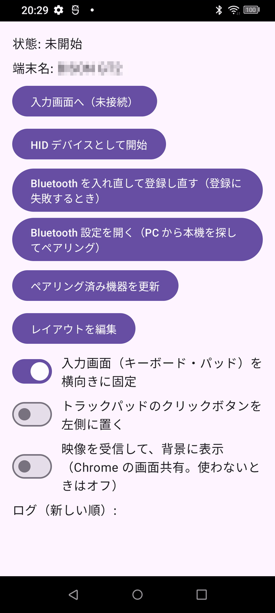
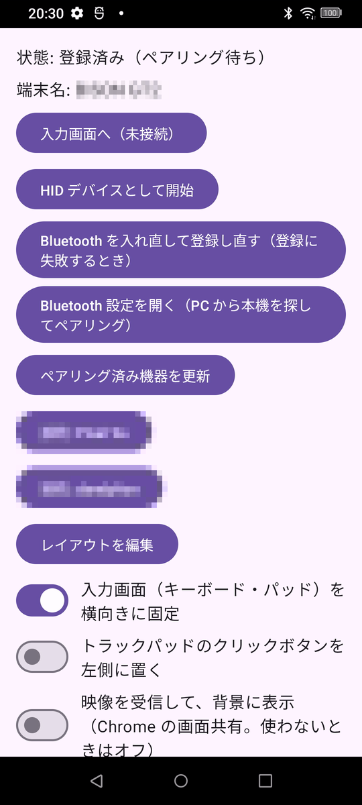
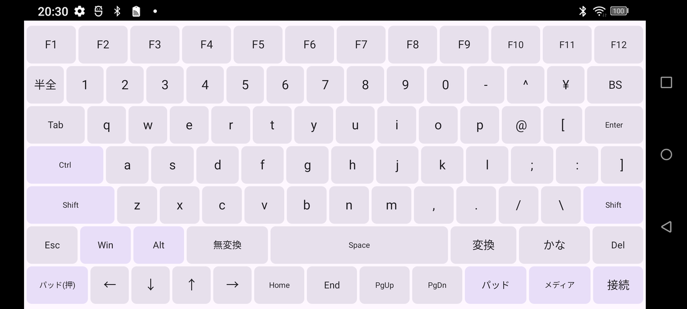
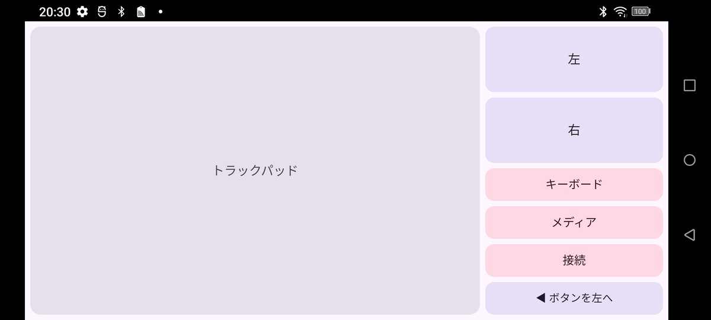
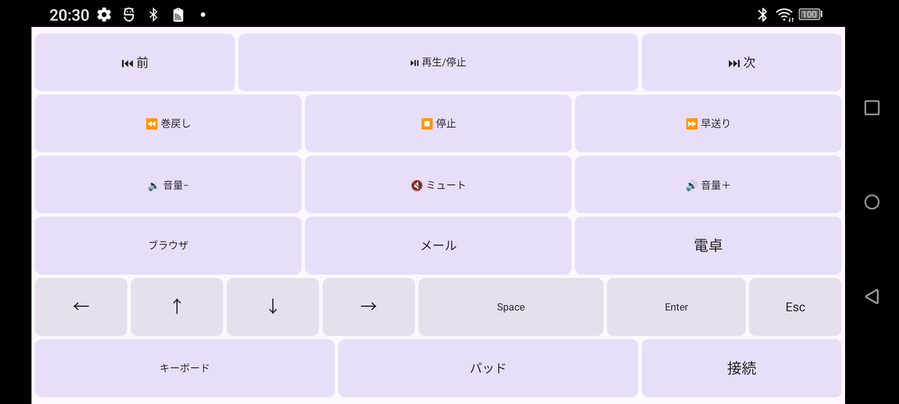
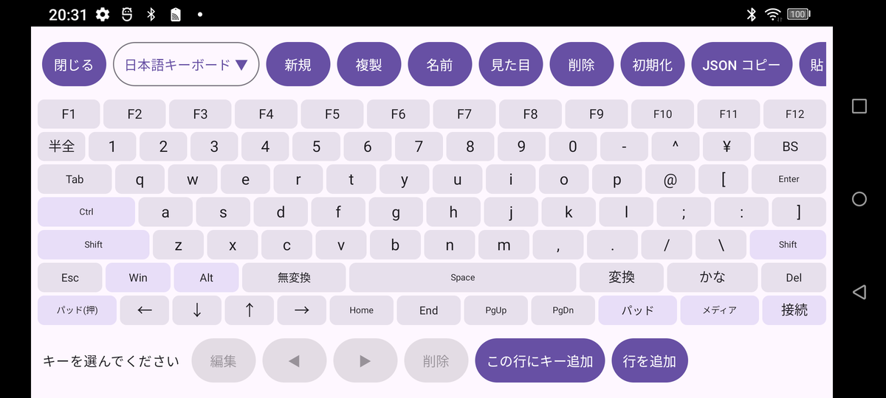
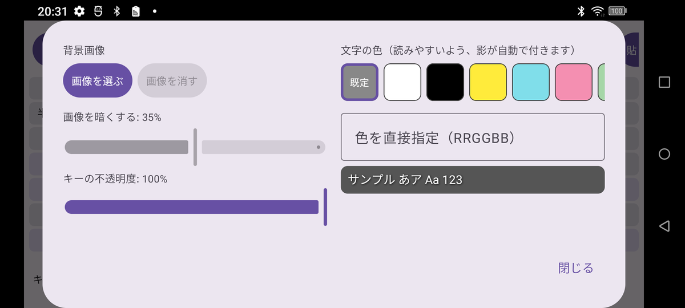
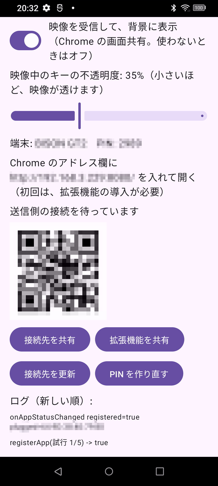
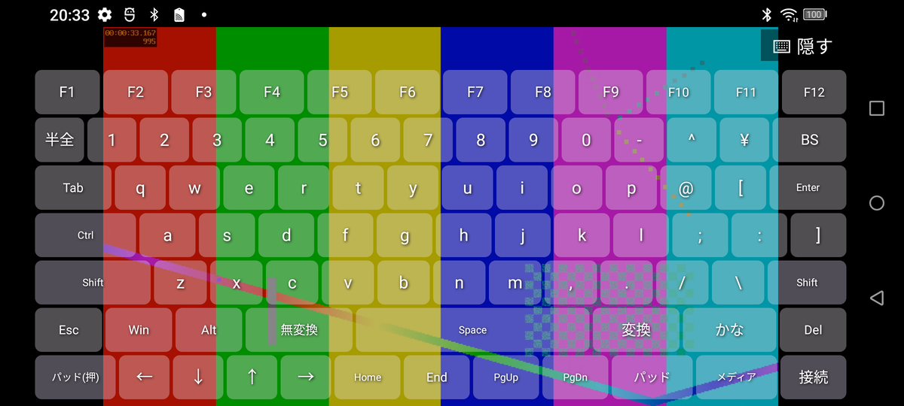
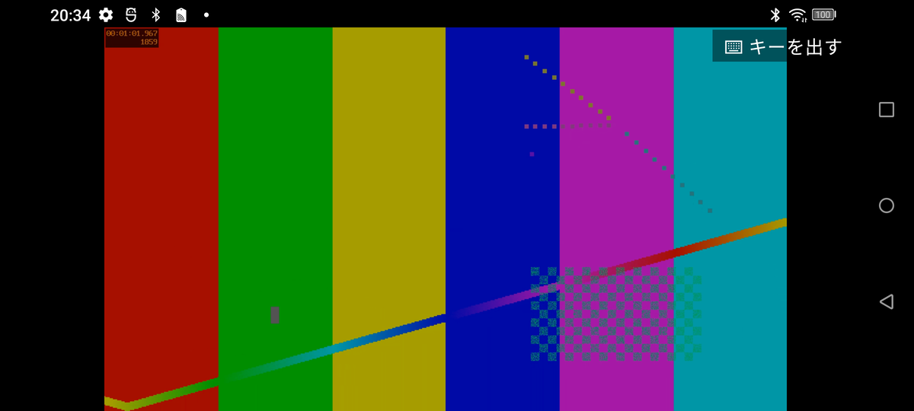

# android-bt-keyboard

使わなくなった Android 端末を、Bluetooth キーボード・トラックパッド・メディアリモコンに変えるアプリです。SIM やネットワークは要りません。端末が HID デバイス（キーボードとマウスを兼ねる機器）のふりをして、PC やスマートフォンとペアリングします。

Android 標準の `BluetoothHidDevice` API を使うので、root 化は不要です。

## 機能

- **キーボード**: 日本語配列（JIS）。F キー、半角/全角、無変換、変換、かな、方向キーなどを含みます。Shift、Ctrl、Alt、Win は、タップして押したままの状態にでき、次のキーを離すと解除されます。
- **メディアリモコン**: 再生/停止、前後、巻戻し・早送り、音量、ミュート、ブラウザ、メール、電卓。
- **トラックパッド**: 1 本指でポインタを動かし、タップで左クリック、2 本指タップで右クリック、2 本指ドラッグでスクロールします。画面の左右ボタンでもクリックできます。クリックボタンの列は、左右どちらにも置けます。
- **押している間だけトラックパッド**: キーボード画面の「パッド(押)」キーを、左手で押している間だけ、トラックパッドが重なって表示されます。押したまま、右手でポインタを操作できます。指を離すと、キーボードに戻ります。
- **レイアウト編集**: キーの追加、移動、削除、表示名・割り当て・幅の変更、行の追加、レイアウトの新規作成・複製・名前変更・削除ができます。レイアウトは JSON で、クリップボード経由でコピーと貼り付けができます。
- **見た目のカスタマイズ**: レイアウトごとに、背景画像、画像の暗さ、キーの不透明度、文字色を設定できます（編集画面の「見た目」）。背景画像や透けたキーの上でも読めるよう、文字には影が付きます。トラックパッドは、直前に使ったレイアウトの見た目になります。
- **入力画面の横向き固定**: キーボード、メディア、トラックパッドの画面を、横向きに固定します（設定でオフにできます）。

## 動作要件

- Android 9（API 28）以降
- 端末の Bluetooth が、HID Device プロファイルに対応していること。メーカーが無効にしている端末では動作しません。

### 動作を確認した環境

- 送信側（このアプリを入れる端末）: UMIDIGI RP03（Android 12）
- 受信側
  - Pixel 9a（Android）: 文字入力、音量、ポインタの移動・クリック・スクロールを確認
  - Linux（BlueZ）: ペアリングと接続、HID デバイスとして認識されることを確認

Windows と macOS は、まだ確認していません。

## インストール

[Releases](https://github.com/seagull-kamome/android-bt-keyboard/releases) の apk をダウンロードして、端末にインストールしてください。

この apk は**デバッグ署名のビルド**です。Play ストアなどでの配布を想定したものではありません。自分で署名したものを使う場合は、下記のとおり、ソースからビルドしてください。

## 使い方

### 1. 接続する



アプリを開くと、まず設定画面が出ます。この画面で、Bluetooth の準備と、各種の設定をします。

1. 「HID デバイスとして開始」を押します（Android 12 以降は、Bluetooth の権限を求められます）。
2. 状態が「登録済み（ペアリング待ち）」になります。「端末名」が、相手の機器から見えるときの名前です。
3. 「Bluetooth 設定を開く」を押して、設定画面を開いたままにします。この間、端末が周囲から見える状態になります。
4. PC やスマートフォンの Bluetooth 設定で、この端末（端末名で表示されます）を探して、ペアリングします。
5. 接続されると、状態が「接続中」になります。

<br clear="all">



登録済みになると、その下に、ペアリング済みの機器が「接続: ○○」というボタンで並びます（画像では、機器の名前にモザイクをかけています）。2 回目以降は、アプリで「HID デバイスとして開始」を押してから、相手の機器から、この端末へ接続するか、このボタンで、こちらから接続します。「ペアリング済み機器を更新」で、一覧を読み直せます。

登録に失敗するときは、「Bluetooth を入れ直して登録し直す」を押してください（詳しくは、[既知の制限](#既知の制限)）。

<br clear="all">

### 2. 入力する

「入力画面へ」を押すと、入力画面になります。入力画面は、横向きに固定されます（設定でオフにできます）。画面の下の段に、画面を切り替えるキーが並びます。

#### キーボード



- Shift、Ctrl、Alt、Win は、タップすると押したままの状態になり、次のキーを離すと解除されます。
- 「パッド(押)」を、左手で押している間だけ、トラックパッドが重なって表示されます。押したまま、右手でポインタを操作できます。指を離すと、キーボードに戻ります。
- 「パッド」と「メディア」で、それぞれの画面へ移ります。「接続」で、設定画面へ戻ります。

#### トラックパッド



- 左の広い面が、トラックパッドです。1 本指でポインタを動かし、タップで左クリック、2 本指タップで右クリック、2 本指ドラッグでスクロールします。
- 右の「左」「右」が、クリックボタンです。「◀ボタンを左へ」で、ボタンの列を、左側に移せます。
- 「キーボード」「メディア」「接続」で、ほかの画面へ移ります。

#### メディアリモコン



再生/停止、前後の曲、巻戻し・早送り、停止、音量、ミュート、ブラウザ、メール、電卓を操作できます。方向キー、Space、Enter、Esc も、ここに並んでいます。

### 3. キーの並びと見た目を変える

設定画面の「レイアウトを編集」で、キーボードの並びを編集できます。



1. 上の段で、編集するレイアウトを選びます。「新規」「複製」「名前」「削除」「初期化」で、レイアウトそのものを操作します。「JSON コピー」と「貼り付け」で、レイアウトをクリップボード経由で、ほかの端末へ移せます。
2. 並んだキーをタップして選ぶと、下の段の「編集」で、表示名、割り当て、幅を変えられます。「◀」「▶」で位置を、「削除」でキーを消せます。
3. 「この行にキー追加」「行を追加」で、キーや行を増やせます。
4. 「閉じる」で、設定画面に戻ります。

「見た目」では、レイアウトごとに、背景や文字を設定できます。



- **背景画像**: 「画像を選ぶ」で、端末の画像を背景にできます。「画像を暗くする」で、画像の上のキーを読みやすくします。
- **キーの不透明度**: 小さくすると、キーが透けて、背景が見えます。
- **文字の色**: 背景や透けたキーの上でも読めるよう、文字には影が付きます。

## 映像を背景に表示する（任意）

ChromeOS や PC の Chrome で「画面共有」した映像を、入力画面の背景に出して、その上に半透明のキーを重ねられます。使わないときは、設定画面のスイッチをオフにしておけば、従来のキーボードのままです（既定はオフ）。



1. 設定画面の下のほうで、「映像を受信して、背景に表示」をオンにします。オンにすると、次のものが出ます（画像では、PIN、接続先の IP アドレス、QR コード、ログの Bluetooth アドレスに、モザイクをかけています）。
   - 映像中のキーの不透明度のスライダー
   - 端末名と PIN（4 桁）
   - 送信側が開く接続先（`http://<本機の IP>:8080/`）と、その QR コード
   - 受信の状態（「送信側の接続を待っています」「接続済み」「受信中」）
   - 「接続先を共有」「拡張機能を共有」「接続先を更新」「PIN を作り直す」のボタン
2. 送信する Chrome で、その接続先を開きます。QR コードを読み取るか、「接続先を共有」で、近距離共有などから送れます。初回は、Chrome 拡張機能の導入が必要です（「拡張機能を共有」で、近距離共有などから渡せます）。
3. 送信側の画面に出る PIN が、狙った端末のものか確かめて、画面共有を始めます。

<br clear="all">

4. 「入力画面へ」で、映像の上に、半透明のキーが重なります（画像は、テスト用の映像です）。



5. 右上の「隠す」で、キーを隠して、映像だけを見られます。「キーを出す」で、元に戻ります。



映像中のキーの不透明度は、設定画面のスライダーで変えます（レイアウトごとの設定と比べて、小さいほうが使われます）。

本機と送信側は、同じ Wi-Fi につないでください。映像の送信側と受信の仕組みは、[android-screen-receiver](https://github.com/seagull-kamome/android-screen-receiver) と同じです。映像の上でのトラックパッド操作は、まだありません。

## ビルド

Nix が使えれば、JDK 17、Gradle、Android SDK 34 を `shell.nix` が用意します（Android SDK のライセンスに同意したものとして扱われます）。

```sh
nix-shell --run "gradle assembleDebug"
# 出力: app/build/outputs/apk/debug/app-debug.apk
```

Gradle Wrapper は含めていません。Nix を使わない場合は、JDK 17 と Android SDK（compileSdk 35、build-tools 34.0.0）を用意して、手元の Gradle（8.9 以降）でビルドしてください。

端末を USB で接続していれば、次のスクリプトで、ビルドからインストール、起動まで行えます。

```sh
./deploy.sh                # ビルド → インストール → 権限付与 → 起動
BT_RESET=1 ./deploy.sh     # 加えて、端末の Bluetooth を入れ直す
```

`tools/pc-input-test.sh` は、接続した相手へ、決まった入力（`text`、`media`、`mouse`）を送って、動作を確認するためのスクリプトです。端末の画面を `adb` で操作します。

## 既知の制限

- **HID の登録が固まることがあります**: アプリを強制終了したり、再インストールしたりすると、Bluetooth 側で前の登録が残って、「登録に失敗しました」と出ることがあります。アプリからは解除できません。接続設定の「Bluetooth を入れ直して登録し直す」を押してください（Android 13 以降は、一般のアプリが Bluetooth を切り替えられないため、設定画面から、手動でオフとオンにしてください）。
- **アプリが前面から外れると、HID の登録が外れる端末があります**: そのため、前面サービス（通知つき）で、登録を保っています。Android 13 以降では、通知の許可を求める処理が、まだありません。
- **背景画像は、レイアウトの JSON に入りません**: JSON のコピーと貼り付けで運べるのは、暗さ・不透明度・文字色の数値だけです。別の端末へ移したあとは、背景画像を選び直してください。選んだ画像は、縮小してアプリ内に保存され、端末の外へは出ません。
- 日本語入力（ローマ字入力）が有効な受信側では、英字がかな変換されます。英語入力に切り替えてください。受信側の「自動大文字化」で、文頭の 1 文字が大文字になることもあります。

## ライセンス

[MIT License](LICENSE)
